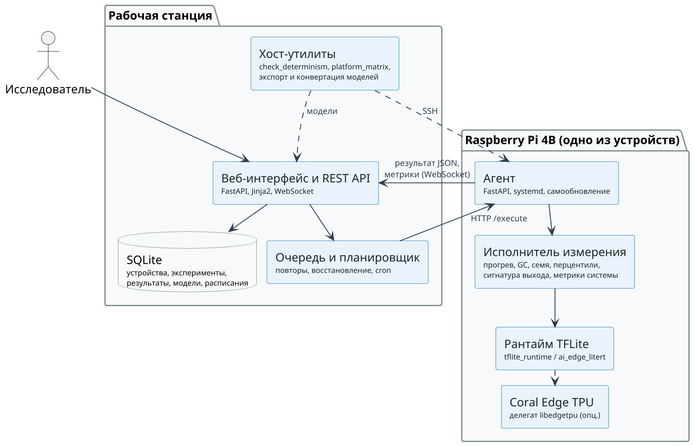
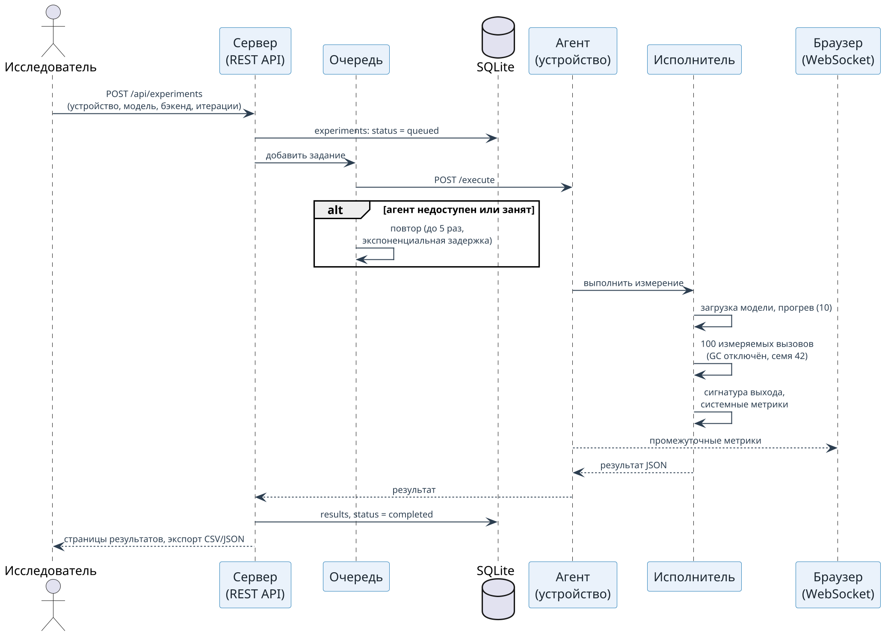

УДК 004.032.26

**Н. С. Колесников, А. Г. Кравец**

# EDGE-BENCH: ПЛАТФОРМА БЕНЧМАРКИНГА НЕЙРОСЕТЕВЫХ МОДЕЛЕЙ НА ГРАНИЧНЫХ УСТРОЙСТВАХ С КОНТРОЛЕМ ЭКВИВАЛЕНТНОСТИ ВЫЧИСЛЕНИЙ

<!-- BEGIN ABSTRACT_RU -->
*Выбор нейросетевой модели для граничного устройства опирается на измерения латентности на целевом оборудовании. В описаниях распространённых инструментов бенчмаркинга не предусмотрена проверка того, что модель на разных устройствах вычисляет один и тот же результат. Провенанс окружения (версии рантайма, частота и температура процессора) при этом обычно теряется. Цель работы — разработать открытую программную платформу распределённого бенчмаркинга моделей TensorFlow Lite, которая фиксирует условия измерения и контролирует эквивалентность выходов между платформами. Задачи: спроектировать клиент-серверную архитектуру с очередью экспериментов и агентами на устройствах; реализовать протокол измерения с прогревом, отключением сборщика мусора и детерминированным входом; ввести сигнатуру выходного тензора и проверку детерминизма модели; провести измерения на реальном оборудовании. Методы: асинхронный сервер FastAPI с хранилищем SQLite, агенты на Raspberry Pi под управлением systemd, перцентильная статистика латентности, сравнение выходов по индексам top-k и контрольной сумме деквантованных значений. Результаты: для MobileNetV2 INT8 на Raspberry Pi 4B медиана латентности составила 5,07 мс на ускорителе Coral Edge TPU (коэффициент вариации 0,48 %) и 33,24 мс на CPU, ускорение 6,56×; в этом прогоне сравнивалась только латентность. Проверка детерминизма выявила модель с именем INT8, у которой 139 из 234 тензоров вещественны. Она давала разный результат при каждом создании интерпретатора и совпадала с эталоном float32 лишь на уровне косинуса 0,50. Латентность этой модели до проверки два месяца числилась в реестре результатов. Новизна состоит в объединении оркестрации измерений, фиксации провенанса и контроля эквивалентности выходов в одной платформе. Практическая значимость — открытая реализация с 86 тестами и непрерывной интеграцией, не требующей оборудования.*
<!-- END ABSTRACT_RU -->

*Граничные вычисления; бенчмаркинг; нейронные сети; квантование INT8; TensorFlow Lite; Edge TPU; Raspberry Pi; воспроизводимость; провенанс измерений; детерминизм вывода.*

**N. S. Kolesnikov, A. G. Kravets**

# EDGE-BENCH: A PLATFORM FOR BENCHMARKING NEURAL NETWORK MODELS ON EDGE DEVICES WITH COMPUTATIONAL EQUIVALENCE CONTROL

<!-- BEGIN ABSTRACT_EN -->
*Selecting a neural network model for an edge device relies on latency measured on the target hardware. Published descriptions of common benchmarking tools do not include a check that the model computes the same answer on different devices, and the environment provenance (runtime versions, CPU frequency, temperature) is usually lost. This work develops an open platform for distributed TensorFlow Lite benchmarking that records measurement conditions and controls output equivalence across platforms. Objectives: design a client-server architecture with an experiment queue and on-device agents; implement a measurement protocol with warm-up, garbage collector suspension and a deterministic input; introduce an output-tensor signature and a model determinism check; measure on real hardware. Methods: an asynchronous FastAPI server with SQLite storage, systemd-managed agents on Raspberry Pi, percentile latency statistics, output comparison by top-k indices and a checksum of dequantized values. Results: for MobileNetV2 INT8 on a Raspberry Pi 4B the median latency was 5.07 ms on the Coral Edge TPU (coefficient of variation 0.48 %) and 33.24 ms on the CPU, a 6.56× latency-only speed-up. The determinism check exposed a model named INT8 in which 139 of 234 tensors were floating-point. It returned a different result on every interpreter construction and matched the float32 reference only at cosine 0.50, yet its latency had been listed in the results registry for two months. The novelty lies in combining measurement orchestration, provenance recording and output equivalence control in one platform; the practical value is an open implementation with 86 tests and hardware-free continuous integration.*
<!-- END ABSTRACT_EN -->

*Edge computing; benchmarking; neural networks; INT8 quantization; TensorFlow Lite; Edge TPU; Raspberry Pi; reproducibility; measurement provenance; inference determinism.*

## Введение

Перенос вывода нейронных сетей с облачных серверов на граничные устройства стал самостоятельным направлением исследований [[shi2016]], [[zhou2019]]. К граничным устройствам относятся одноплатные компьютеры, микроконтроллеры и специализированные ускорители. Выбор архитектуры модели, схемы квантования и рантайма для них опирается на измерения на целевом оборудовании. Измеряются латентность одного вывода, пропускная способность, резидентная память и тепловой режим.

Эталонные наборы MLPerf Inference [[reddi2020]] и MLPerf Tiny [[banbury2021]] задают протоколы для серверных и микроконтроллерных систем, AI Benchmark [[ignatov2019]] покрывает смартфоны. Работы [[bianco2018]], [[hadidi2019]], [[baller2021]] сравнивают коммерческие граничные платформы на фиксированном наборе моделей. Для исследовательской практики эти инструменты неудобны по одной из двух причин: одни поставляются как фиксированные наборы с собственными моделями, другие являются одноразовыми сценариями измерения на одном устройстве и не сохраняют условий эксперимента.

Результат бенчмарка на граничном устройстве определяется не только моделью. На него влияют версия рантайма и способ его установки, число потоков и режим управления частотой процессора. Влияют также тепловое состояние платы и распределение входных данных, от которого зависят пути исполнения квантованных ядер. Если эти условия не записаны вместе с числом, число невоспроизводимо. Проблема воспроизводимости в машинном обучении хорошо документирована [[gundersen2018]], [[pineau2020]]. Для аппаратных замеров на граничных устройствах она обычно сводится к требованию указать оборудование.

Вторая, менее очевидная проблема состоит в том, что бенчмарк, который измеряет только время вызова интерпретатора, не отличает корректную модель от модели с ошибочным выходом. Неверно скомпилированная для ускорителя сеть, сломанный делегат или модель с не той схемой квантования тоже исполняются и дают число латентности. Сравнение двух устройств по латентности осмысленно, когда на одном входе они вычислили одно и то же. В описаниях перечисленных инструментов сравнение выходов между устройствами в процедуру измерения не включено (раздел 3.3).

В настоящей работе представлена edge-bench — открытая программная платформа с тремя функциями. Первая функция — распределённый запуск измерений на парке устройств через лёгкие агенты. Вторая — фиксация провенанса каждого результата: модели, параметров, версий рантайма, частотно-тепловых рядов. Третья — контроль эквивалентности вычислений между платформами по сигнатуре выходного тензора. Отличие от существующих решений состоит в третьей функции и её сочетании с первыми двумя. В матрице платформ сравнение латентностей сопровождается вердиктом о совпадении ответа на одном входе, а прогоны с расхождением ответа помечаются как несопоставимые. Работоспособность подхода показана на Raspberry Pi 4B с ускорителем Coral Edge TPU и без него. Показано также обнаружение дефектной модели, латентность которой ранее считалась установленной.

## 1. Постановка задачи

Объектом исследования является процесс измерения производительности нейросетевых моделей на граничных устройствах. Предмет исследования — программная архитектура и протокол измерения, обеспечивающие воспроизводимость и сопоставимость результатов между устройствами. Цель работы — разработать платформу распределённого бенчмаркинга моделей TensorFlow Lite (TFLite), которая фиксирует условия измерения и проверяет эквивалентность вычислений между платформами. TensorFlow Lite является рантаймом вывода из экосистемы TensorFlow [[abadi2015]]; работоспособность платформы требуется подтвердить измерениями на реальном оборудовании.

Для достижения поставленной цели необходимо решить следующие задачи:

1) спроектировать клиент-серверную архитектуру, в которой сервер управляет очередью экспериментов и хранит результаты, а агенты на устройствах выполняют измерения;
2) реализовать протокол измерения латентности, устойчивый к известным источникам искажений: прогреву, сборщику мусора, изменению частоты процессора, распределению входа;
3) определить сигнатуру выходного тензора и процедуру проверки детерминизма модели для сравнения устройств с разными рантаймами и ускорителями;
4) обеспечить полноту провенанса результата и качество программной реализации: тесты, непрерывную интеграцию, контейнеризацию;
5) провести измерения на Raspberry Pi 4B с ускорителем Edge TPU и без него и оценить, что даёт проверка эквивалентности на практике.

Требования к платформе сформулированы исходя из условий исследовательской лаборатории. Устройства подключены к локальной сети без выхода в Интернет. Их число невелико (единицы), но состав меняется; графических процессоров и CUDA на устройствах нет. Сервер должен запускаться без конфигурации на рабочей станции или в контейнере. Измерение должно быть воспроизводимо по одному файлу результата, в котором есть все параметры, необходимые для повторения прогона. В нём же должны быть признаки, по которым результат может быть отвергнут: троттлинг, падение частоты, отсутствие ускорителя. Наконец, результат должен содержать компактное свидетельство того, что вычислила модель, а не только того, как быстро.

Гипотеза. Включение проверки выходов в процедуру измерения позволяет обнаруживать дефектные модели и сборки, которые при сравнении только по латентности выглядят как обычные варианты модели. Тем самым снижается риск попадания невалидных чисел в публикуемые сравнения. Гипотеза проверяется в разделе 3 на корпусе моделей проекта.

## 2. Методика исследования: архитектура платформы и протокол измерения

Платформа построена экспериментально в четыре этапа. На первом этапе созданы сервер и агент с базовым измерением латентности. На втором по итогам первых прогонов на Raspberry Pi расширены протокол измерения и провенанс результата. На третьем после обнаружения расхождений между устройствами введены сигнатура выхода и проверка детерминизма. На четвёртом построена сравнительная матрица платформ и проверен корпус моделей. Каждый этап завершался измерением на реальном оборудовании, результаты которого хранятся в репозитории вместе с исходным кодом.

Архитектура опирается на четыре принципа. Во-первых, сервер, агент и утилиты являются независимыми пакетами с интерфейсами HTTP. Во-вторых, агент на устройстве зависит только от рантайма TFLite, `numpy` и `psutil`. В-третьих, измерение реализовано в единственном модуле, который используют и агент, и автономные сценарии. Расхождение копий измерительного кода является типичной причиной несовпадения «одинаковых» прогонов. Наконец, обязательной конфигурации платформа не требует.

### 2.1. Компоненты системы и их взаимодействие

Платформа состоит из трёх частей (рис. 1). Сервер — асинхронное приложение на FastAPI, которое ведёт реестр устройств, принимает модели, управляет очередью экспериментов, хранит результаты в SQLite и отдаёт веб-интерфейс. Агент — лёгкий HTTP-сервис на устройстве, который по запросу сервера загружает модель, выполняет измерение и возвращает результат. Агент устанавливается одной командой через эндпоинт `/install` сервера. Сценарий установки создаёт виртуальное окружение, регистрирует службу systemd и устройство в реестре. Хост-утилиты — сценарии для рабочей станции: проверка детерминизма, сравнительная матрица платформ, конвертация и экспорт моделей.

{width=13cm}

**Рис. 1.** Компонентная архитектура платформы edge-bench. Сплошные стрелки — запросы HTTP; пунктирные — потоки данных и управляющие каналы (SSH).

Взаимодействие компонентов при выполнении эксперимента показано на рис. 2. Пользователь создаёт эксперимент через веб-интерфейс или REST-запрос и указывает устройство, модель, бэкенд (`cpu` или `edgetpu`), число потоков, число прогревочных и измеряемых итераций. Сервер ставит эксперимент в очередь, а обработчик очереди последовательно отправляет задания агентам. При недоступности или занятости агента попытка повторяется до пяти раз с экспоненциальной задержкой, а после перезапуска сервера очередь восстанавливается из базы данных. В ходе измерения агент передаёт серверу промежуточные метрики, которые транслируются в браузер по WebSocket. Результат сохраняется в базе и доступен на страницах сравнения и для экспорта в CSV и JSON. Планировщик на основе APScheduler запускает регулярные прогоны по cron-выражению; расписания хранятся в базе и переживают перезапуск.

{width=13cm}

**Рис. 2.** Последовательность выполнения эксперимента: от постановки в очередь до сохранения результата.

Состав реализации приведён в таблице 1; веб-интерфейс отрисовывается на сервере шаблонами Jinja2 без сборки фронтенда. Библиотека графиков включена в поставку, поэтому интерфейс работает в изолированной сети. Настройки задаются переменными окружения с рабочими значениями по умолчанию. Единственный секрет — общий ключ агента, который включает аутентификацию запросов к API.

**Таблица 1.** Состав платформы edge-bench.

| Компонент | Технологии | Объём, строк Python | Назначение |
|---|---|---:|---|
| Сервер (`server/`) | FastAPI, uvicorn, aiosqlite, APScheduler, Jinja2 | 5320 | 86 маршрутов API и интерфейса, очередь, планировщик, WebSocket, 9 таблиц SQLite |
| Агент (`agent/`) | FastAPI, рантайм TFLite, numpy, psutil | 3392 | Исполнение измерений, сбор системных метрик, локальный кэш результатов, самообновление |
| Хост-утилиты (`scripts/`) | numpy, SSH | 3379 | Проверка детерминизма, матрица платформ, экспорт и конвертация моделей |
| Тесты (`tests/`) | pytest | 2028 | 86 тестов, из них 11 аппаратных — помечены отдельно и пропускаются без рантайма |

### 2.2. Протокол измерения латентности

Измерение выполняет единственный модуль агента в распределённом и в автономном режиме по шести правилам.

1. Прогрев. Заданное число итераций (по умолчанию 10) выполняется до измерения и исключается из статистики. Время первой итерации записывается отдельно как часть холодного старта.
2. Сборщик мусора. На время каждого измеряемого вызова интерпретатора сборщик мусора Python отключается. Сразу после вызова он восстанавливается и поэтому не искажает ни латентность, ни память.
3. Детерминированный вход. Входной тензор генерируется из фиксированного семени (по умолчанию 42) с учётом типа данных модели. Целочисленный вход заполняется равномерно по всему диапазону типа, вещественный — в диапазоне [0, 1]. Вход строится генератором NumPy RandomState (MT19937), поток которого сохраняется между версиями NumPy. Поэтому одно семя на всех устройствах даёт побайтово идентичный вход, что необходимо для сравнения выходов. Квантованные ядра могут выбирать разные пути исполнения в зависимости от распределения входа, поэтому семя записывается в результат.
4. Статистика. По измеряемым итерациям вычисляются среднее, стандартное отклонение, минимум, максимум и перцентили p50, p75, p90, p95, p99. Вычисляются также межквартильный размах, коэффициент вариации и число выбросов; все отдельные значения сохраняются. Перцентили вычисляются линейной интерполяцией, выбросом считается значение, отстоящее от среднего более чем на три стандартных отклонения. Пропускная способность приводится по среднему и по медиане, поскольку при тяжёлом хвосте они расходятся.
5. Системные метрики. Параллельный поток с шагом не более 100 мс регистрирует загрузку и частоту процессора, температуру и резидентную память процесса измерения. Предупреждение формируется, если температура достигла 80 °C или частота упала не менее чем на 15 % от начальной; результат с предупреждением помечается и не цитируется.
6. Режим частоты. Для публикуемых чисел регулятор частоты переводится в режим `performance`. В режиме `powersave` снижение частоты в простое неотличимо от троттлинга, и прогон получает предупреждение.

Холодный старт измеряется отдельно как сумма времени загрузки модели и времени первого вывода. Для Edge TPU загрузка включает передачу модели на устройство и занимает секунды. Установившаяся латентность при этом составляет миллисекунды, поэтому эти величины не смешиваются.

### 2.3. Провенанс результата

Файл результата должен позволять повторить прогон и отвергнуть его при нарушении условий. Поэтому агент записывает поля, перечисленные в таблице 2. Отметим поле источника рантайма. На Raspberry Pi OS используется классический пакет `tflite_runtime`, на рабочих станциях с современным CPython — его преемник `ai_edge_litert`. При отсутствии обоих используется полный TensorFlow. Облегчённые рантаймы выбираются первыми, чтобы измерение на устройстве не зависело от наличия полного пакета. Выбранный источник и его версия попадают в результат, поскольку они влияют на латентность.

**Таблица 2.** Поля записи результата.

| Группа | Поля |
|---|---|
| Модель | имя, префикс SHA-256, размер, схема квантования, форма и тип входа и выхода |
| Параметры | запрошенный и фактический бэкенд, обнаружен ли ускоритель, число потоков, число прогревочных и измеряемых итераций, семя входа |
| Латентность | среднее, отклонение, минимум, максимум, перцентили, все отдельные значения |
| Пропускная способность | по среднему и по медиане |
| Холодный старт | время загрузки модели, время первого вывода |
| Система | ряды загрузки CPU, резидентной памяти, температуры и частоты; предупреждения |
| Устройство и рантайм | модель платы, ядро, архитектура, версии Python, numpy, источника TFLite, библиотеки Edge TPU, регулятор частоты |
| Сигнатура выхода | индексы top-k, контрольная сумма, сумма, среднее и норма деквантованного тензора |

Измеренные прогоны хранятся в каталоге результатов репозитория вместе с нормализованной сводкой. Сводка содержит сценарий, машину, ревизию git и ключевые метрики. Эти файлы являются входными данными для реестра результатов диссертации. Выход коротких проверочных прогонов в этот каталог не попадает и не цитируется.

### 2.4. Сигнатура выхода и проверка детерминизма

Хранить полный выходной тензор нецелесообразно. Для обнаружения неверно скомпилированной модели или сломанного делегата достаточно компактной сигнатуры. После измерения агент считывает выходной тензор и снимает аффинное квантование по масштабу и нулевой точке. Благодаря этому INT8-модель для CPU и её сборка для Edge TPU сравниваются в одних единицах. Сигнатура включает индексы $k$ наибольших значений ($k = 5$). Для классификатора это его решение, для экстрактора признаков — номера наибольших компонент вектора. В неё входит также контрольная сумма как критерий точного совпадения. Она вычисляется функцией SHA-256 по деквантованным значениям в формате float64, округлённым до шести знаков, и хранится первыми 16 шестнадцатеричными символами. Сумма, среднее и евклидова норма тензора дополняют сигнатуру. Для нормы при сравнении вычисляется относительное расхождение; порог для него не задаётся, и на вердикт оно не влияет.

Под контролем эквивалентности в работе понимается проверка совпадения решения модели на одном входе по сигнатуре выхода. Сравнение двух сигнатур даёт один из вердиктов таблицы 3. Вердикт относится к решению модели на одном входе. Он не устанавливает эквивалентности выходных тензоров в целом и не заменяет проверки точности на размеченном наборе. Утилита сравнительной матрицы запускает одну модель на нескольких целях вида `имя=хост:бэкенд[@модель]`. Пустой хост означает текущую машину. Переопределение модели нужно для Edge TPU, которому требуется собственная скомпилированная сборка. Сравнение сборки для ускорителя с исходной сборкой для CPU является основным случаем применения. При расхождении top-1 утилита завершается с ненулевым кодом возврата. Поэтому её можно использовать как проверку перед публикацией результатов или выпуском версии.

**Таблица 3.** Вердикты сравнения сигнатур выхода.

| Вердикт | Условие |
|---|---|
| Точное совпадение | совпадают контрольные суммы деквантованных тензоров |
| Совпадение top-k при разной арифметике | совпадают индексы top-k, контрольные суммы различаются (ожидаемо для разных ядер и ускорителей) |
| Совпадение top-1 при разном ранжировании | совпадает индекс top-1, порядок остальных индексов различается |
| Расхождение | индекс top-1 различается; сравнение латентностей недопустимо |

Проверка детерминизма отвечает на вопрос, который сравнение устройств не ставит: возвращает ли модель одно и то же на одном входе. Одинаковый тензор подаётся нескольким заново созданным интерпретаторам (по умолчанию шести) и повторно одному интерпретатору. Сравнение двух рядов разделяет два случая. В первом различаются заново созданные интерпретаторы, а повторные вызовы одного совпадают. Тогда выход зависит от состояния, которое устанавливается при построении интерпретатора или выделении памяти и не задаётся входом. Во втором различаются и повторные вызовы, то есть недетерминизм лежит внутри исполнения (потоки, планирование). Дополнительно подсчитывается доля вещественных тензоров в графе. Если у модели с именем INT8 первая операция — деквантование, а значительная часть тензоров вещественна, вывод не является полноцелочисленным. Латентность такой модели поэтому не характеризует INT8-путь. Проверка завершается ненулевым кодом при любом недетерминизме и применяется ко всему корпусу моделей одной командой.

### 2.5. Качество реализации и непрерывная интеграция

Проверки качества разделены на два уровня. Первый уровень включает линтер, проверку форматирования, статическую типизацию пакета сервера, тесты с покрытием и проверку импорта приложения. Он не требует ни графического процессора, ни ускорителя, ни весов моделей и выполняется на любом облачном раннере. Второй уровень — аппаратная валидация: тесты с аппаратной меткой и короткий проверочный прогон на реальном рантайме. Они выполняются на самостоятельном раннере. При отсутствии рантайма или модели такие тесты пропускаются, а не имитируются. Все проверки оформлены как цели `make`, поэтому конвейер не зависит от провайдера. Приложение поставляется многоэтапным Docker-образом с зависимостями из файла блокировки. Оно запускается от непривилегированного пользователя и проверяется по эндпоинту состояния. Отдельный образ позволяет выполнить измерение на хосте без пригодного Python.

## 3. Результаты и их обсуждение

### 3.1. Стенд и измерения на реальном оборудовании

Стенд описан в таблице 4. Основная модель — MobileNetV2 [[sandler2018]] с входом 224×224. Она квантована до INT8 методом постобучающего квантования [[jacob2018]], [[krishnamoorthi2018]], [[nagel2021]]. Калибровочная выборка содержит 512 изображений цветной части набора PlantVillage [[hughes2015]]. Они выбраны случайно с семенем 42 из упорядоченного списка файлов всех классов. Изображения приводятся к 224×224, масштабируются в [0, 1] и нормализуются по статистикам ImageNet. Источник, число и семя калибровки записываются в паспорт сборки. Это конфигурация C6 программного комплекса диагностики заболеваний растений, для которой платформа и создавалась. Для проверки сравнения трёх платформ использована также модель MobileNetV1 INT8 [[howard2017]]. Для ускорителя Coral Edge TPU [[cass2019]], [[coral2019]] модель компилируется отдельно. Сборка считается полностью отображённой, если все операции графа исполняются на ускорителе.

**Таблица 4.** Стенд измерений.

| Параметр | Граничное устройство | Рабочая станция |
|---|---|---|
| Платформа | Raspberry Pi 4 Model B Rev 1.5 [[raspberrypi]], 8 ГБ ОЗУ, ARM Cortex-A72, 1800 МГц | AMD Ryzen 7 7700, x86_64 |
| Ускоритель | Coral USB Accelerator (Edge TPU), USB 3.0 | — |
| ОС, ядро | Raspberry Pi OS 64-bit, Linux 6.12.93, glibc 2.36 | Linux, glibc 2.42 |
| Python, рантайм | 3.11.2, tflite_runtime 2.14.0 | ai_edge_litert 2.1.6 |
| Протокол | 10 прогревочных, 100 измеряемых итераций, семя 42, 4 потока, регулятор `performance` | то же, 50 итераций в матрице платформ |

Результаты для MobileNetV2 INT8 на Raspberry Pi 4B приведены в таблице 5 по файлам прогона 14 августа 2026 г.; выполнено 100 измеряемых итераций. Оба столбца получены на одной сборке `c6_mobilenet_v2_int8_tpu` (маршрут torchvision → клон Keras → TFLiteConverter, косинус к float32 0,9692, таблица 8). На CPU исполнялся исходный файл, на ускорителе — та же сеть после компилятора Edge TPU 16.0 с отображением 68 из 68 операций. Хэши обоих файлов записаны в результатах, исходные файлы прогона находятся в каталоге `results/2026-08-14_c6_edgetpu/` репозитория, файлы матриц платформ — в `results/platform_matrix/`. В этом прогоне записана латентность, но не сигнатура выхода. Поэтому таблица 5 является сравнением латентностей без проверки выходов, и вердикта эквивалентности для MobileNetV2 на паре CPU и Edge TPU нет. Для MobileNetV2 вердикт получен только для сборки маршрута ONNX на CPU: в матрице платформ от 13 августа 2026 г. рабочая станция и Raspberry Pi 4B дали вердикт «совпадение top-1 при разном ранжировании». Пара CPU и Edge TPU с вердиктом получена для MobileNetV1 (таблица 6); на сборку MobileNetV2 для Edge TPU этот вывод не переносится.

**Таблица 5.** MobileNetV2 INT8 на Raspberry Pi 4B: CPU и Edge TPU.

| Показатель | CPU (4 потока) | Edge TPU |
|---|---:|---:|
| Латентность, среднее ± отклонение, мс | 33,40 ± 0,98 | 5,08 ± 0,02 |
| Медиана p50, мс | 33,24 | 5,07 |
| p95 / p99, мс | 34,41 / 35,23 | 5,12 / 5,15 |
| Коэффициент вариации, % | 2,94 | 0,48 |
| Выбросов из 100 | 1 | 1 |
| Пропускная способность, вывод/с | 29,9 | 197,0 |
| Загрузка модели, мс | 2,9 | 2647,5 |
| Первый вывод, мс | 37,4 | 13,5 |
| Резидентная память процесса, МБ | 47,6 | 47,7 |
| Загрузка CPU, % (среднее) | 87,9 | 5,5 |
| Температура, начало → конец, °C | 39,4 → 43,8 | 38,0 → 39,4 |
| Предупреждения о троттлинге | нет | нет |

Ускоритель сокращает медиану латентности в 6,56 раза и уменьшает разброс. Коэффициент вариации составляет 0,48 % против 2,94 % на CPU, размах между минимумом и максимумом — 0,15 мс против 9,3 мс. Загрузка процессора падает с 88 % до 5 %. Арифметика выполняется на ускорителе, а процессору остаются подготовка входа и передача данных по USB. Цена ускорения — холодный старт: загрузка модели на Edge TPU занимает 2,65 с против 2,9 мс на CPU. Если устройство просыпается, обрабатывает один кадр и засыпает, время отклика определяется именно этой величиной. Поэтому платформа сообщает её отдельно от установившейся латентности. Резидентная память процесса в обоих случаях составляет около 48 МБ. Она почти не зависит от бэкенда и многократно превышает объём модели 2,6–2,8 МБ.

Сравнение трёх платформ на модели MobileNetV1 INT8 показано в таблице 6. Выполнено 50 измеряемых итераций, эталоном служит рабочая станция. Рабочая станция быстрее Raspberry Pi на CPU в 36 раз. Ускоритель Edge TPU на Raspberry Pi уступает рабочей станции лишь в 5 раз. Таблица построена после проверки выходов на одном входе. На всех трёх целях совпали индексы top-5, контрольные суммы различаются. Относительное расхождение евклидовой нормы выхода составляет 0,17 и 0,18 %. Различие контрольных сумм при совпадении ранжирования согласуется с разной реализацией целочисленной арифметики в ядрах CPU и в ускорителе. Вердикт «совпадение top-k при разной арифметике» фиксирует именно этот случай.

**Таблица 6.** Матрица платформ для MobileNetV1 INT8.

| Цель | Рантайм | p50, мс | p95, мс | Вывод/с | Резидентная память, МБ | Загрузка модели, мс | Вердикт | Δ нормы, % |
|---|---|---:|---:|---:|---:|---:|---|---:|
| x86_64, CPU | ai_edge_litert 2.1.6 | 0,91 | 1,22 | 1011 | 61,8 | 4,6 | эталон | — |
| RPi 4B, CPU | tflite_runtime 2.14.0 | 33,02 | 35,98 | 29,8 | 51,2 | 1,7 | совпадение top-5 | 0,17 |
| RPi 4B, Edge TPU | tflite_runtime 2.14.0 | 4,70 | 4,78 | 211,9 | 51,5 | 2677,0 | совпадение top-5 | 0,18 |

### 3.2. Обнаружение дефектной модели

Практическую ценность проверки показал корпус моделей самого проекта. Модель конфигурации C6 с `int8` в имени два месяца числилась в реестре результатов. Её латентность была измерена 6 июня 2026 г. Проверка детерминизма, введённая на третьем этапе разработки, показала, что модель возвращает разный результат при каждом заново созданном интерпретаторе. Это воспроизвелось на двух рантаймах и двух архитектурах: `ai_edge_litert` 2.1.6 на x86_64 и `tflite_runtime` 2.14.0 на aarch64. Разбор графа выявил несоответствие схеме квантования. Первой операцией было деквантование, а 139 из 234 тензоров были вещественными. Модель несла квантование только весов, а не полноцелочисленную схему остальных моделей корпуса. Причина недетерминизма при этом не установлена: разбор графа объясняет только несоответствие схеме. Косинусное сходство выходных признаков модели с эталоном float32 на 64 отложенных изображениях, не входивших в калибровку, составило 0,50. Модель C6 выдаёт вектор признаков после глобального усреднения, и косинус вычислялся между такими векторами. На той же выборке из 64 изображений получены значения 0,9912 и 0,9692 в таблице 8.

Архивная копия этой сборки перепроверена 14 сентября 2026 г. на рабочей станции (`ai_edge_litert` 2.1.6). Шесть заново созданных интерпретаторов дали шесть различных выходов, повторные вызовы внутри одного интерпретатора совпали. Вещественных тензоров снова оказалось 139 из 234. Латентность этой модели была измерена корректно, но относилась не к INT8-выводу. Число отозвано из реестра.

Матрица платформ от 13 августа 2026 г. с дефектной сборкой в качестве эталона показывает такой случай в сравнении устройств (таблица 7). Выполнено 50 итераций, эталоном служит старая сборка на x86_64. Ни одна цель не совпала с эталоном даже по top-1. Относительное расхождение нормы выхода составило 24–49 %. Латентность дефектной сборки на Raspberry Pi была выше и нестабильнее, чем у исправленной: стандартное отклонение 31,7 мс против 1,6 мс. Следовательно, по латентности дефектная сборка от исправленной отличалась. Без сигнатуры выхода это различие выглядело бы как обычное сравнение двух версий модели, а не как признак дефекта.

**Таблица 7.** Матрица платформ для дефектной (старой) и исправленной (новой) сборок C6.

| Цель | p50, мс | Среднее ± отклонение, мс | Вывод/с | Вердикт относительно эталона | Δ нормы, % |
|---|---:|---:|---:|---|---:|
| x86_64, старая сборка | 7,78 | 7,78 ± 0,46 | 128,6 | эталон | — |
| x86_64, новая сборка | 4,07 | 4,11 ± 0,21 | 243,2 | расхождение | 24,9 |
| RPi 4B, старая сборка | 122,61 | 137,90 ± 31,75 | 7,3 | расхождение | 49,2 |
| RPi 4B, новая сборка | 55,67 | 55,97 ± 1,60 | 17,9 | расхождение | 24,0 |

После исправления получены три сборки из одного источника и одной калибровки (таблица 8). Косинус к float32 характеризует близость выхода к исходной модели, а не точность классификации на размеченном наборе. Сборка через ONNX и инструмент ai-edge-quantizer ближе всех к float32 (косинус 0,9913), но не компилируется для Edge TPU. Клон архитектуры в Keras воспроизводит эталон torchvision с косинусом 0,99999988. После квантования через ai-edge-quantizer он даёт косинус 0,9912 и латентность 33,07 мс на CPU. Однако компилятор Edge TPU версии 16.0 отображает на ускоритель лишь 4 из 68 операций. Компилятор сообщает о неконстантных параметрах для 48 свёрток, веса которых являются обычными константами INT8. Та же сеть, квантованная штатным конвертером TFLite, отображается полностью (68 из 68 операций), но косинус снижается до 0,9692.

**Таблица 8.** Сборки MobileNetV2 INT8 из одного источника и одной калибровки.

| Сборка | Маршрут | Косинус к float32 | RPi 4B CPU, p50, мс | Операций на Edge TPU |
|---|---|---:|---:|---|
| `c6_mobilenet_v2_int8` | ONNX → onnx2tf → ai-edge-quantizer | 0,9913 | 55,99 | не компилируется |
| `c6_mobilenet_v2_int8_accurate` | torchvision → клон Keras → ai-edge-quantizer | 0,9912 | 33,07 | 4 из 68 |
| `c6_mobilenet_v2_int8_tpu` | torchvision → клон Keras → TFLiteConverter | 0,9692 | 33,24 | 68 из 68 |

Латентность сборки `_accurate` измерена 23 октября 2026 г. тем же сценарием и с теми же параметрами, что и прогон 14 августа (файлы в каталоге `results/2026-10-23_c6_accurate_cpu/`); контрольный повтор сборки `_tpu` в той же сессии дал 33,03 мс, поэтому на CPU две сборки маршрута Keras по латентности неразличимы. Ни одна из трёх сборок не сочетает косинус выше 0,99 с полным отображением на ускоритель. Версия 16.0 остаётся последним публичным выпуском компилятора [[coral2019]], поэтому сменой версии это ограничение не обходится. Выбор сборки определяется задачей, а число отображённых операций и косинус к эталону входят в нормализованную сводку результата, и компромисс виден до выбора.

Латентность двух сборок с косинусом выше 0,99 различается: 55,99 против 33,07 мс при одинаковой архитектуре и разрядности. В этом эксперименте маршрут конвертации связан с различием времени вывода в 1,7 раза. Это довод за фиксацию хэша модели и маршрута её получения в провенансе. Проверка детерминизма текущего корпуса охватила 48 файлов, из них 23 сборки для Edge TPU на рабочей станции пропущены. Проверка завершилась с нулевым кодом возврата. Каждая проверенная модель дала один выход на шести заново созданных интерпретаторах и на шести повторных вызовах. Доля вещественных тензоров равна нулю для сборок маршрута Keras (0 из 175) и для моделей MobileNetV1 и ResNet-50. У трёх моделей float32 (`model_fp32_*`) вещественны 138 из 143 тензоров, что соответствует их имени. У сборки маршрута ONNX `c6_mobilenet_v2_int8` вещественны 20 из 271 тензоров. Это пути «деквантование → дополнение нулями → повторное квантование», которые onnx2tf порождает вокруг пяти свёрток с дополнением. Сборка детерминирована, но не является полноцелочисленной в строгом смысле. Её латентность 55,99 мс относится именно к такому графу, и проверка показывает это различие до публикации числа.

### 3.3. Сравнение с существующими инструментами

MLPerf Inference [[reddi2020]] и MLPerf Tiny [[banbury2021]] задают строгие протоколы. Качество модели в них контролируется целевой точностью на эталонном наборе данных. Эти наборы ориентированы на сопоставление систем поставщиков на фиксированных задачах, а не на измерение произвольной исследовательской модели на парке устройств лаборатории. AI Benchmark [[ignatov2019]] является приложением для смартфонов с закрытой процедурой. Работы [[hadidi2019]] и [[baller2021]] содержат ценные измерения коммерческих граничных платформ, но являются прежде всего исследованиями, а не переиспользуемыми инструментами. Анализ DAWNBench [[coleman2019]] показал чувствительность результатов к деталям постановки даже при фиксированном протоколе. Это согласуется с необходимостью фиксировать провенанс. Сравнения выходов между устройствами на одном входе и проверки детерминизма модели в описаниях перечисленных инструментов не обнаружено.

Сопоставление приведено в таблице 9. Оценка «частично» означает, что инструмент публикует описание системы, но не сохраняет частотно-тепловые ряды и версии рантайма в каждом файле результата. Оценки основаны на публикациях и открытой документации инструментов и относятся к версиям, описанным в цитируемых работах 2019–2021 гг. На общем стенде инструменты не запускались.

**Таблица 9.** Функциональное сравнение с инструментами бенчмаркинга.

| Инструмент | Целевые системы | Произвольная модель | Распределённый запуск на парке устройств | Провенанс окружения в результате | Сравнение выходов между устройствами | Открытый код |
|---|---|:---:|:---:|:---:|:---:|:---:|
| MLPerf Inference [[reddi2020]] | серверы, рабочие станции, граничные устройства | нет | нет | частично | нет | да |
| MLPerf Tiny [[banbury2021]] | микроконтроллеры | нет | нет | частично | нет | да |
| AI Benchmark [[ignatov2019]] | смартфоны | нет | нет | нет | нет | нет |
| DeepEdgeBench [[baller2021]] | одноплатные компьютеры, ускорители | да | нет | частично | нет | да |
| edge-bench (данная работа) | одноплатные компьютеры, Edge TPU, x86 | да | да | да | да | да |

### 3.4. Ограничения

Границы полученных результатов следующие. Платформа поддерживает только рантайм TensorFlow Lite и его преемник. ONNX Runtime, TensorRT и графические процессоры не поддерживаются, энергопотребление не измеряется. Все аппаратные измерения выполнены на одном экземпляре Raspberry Pi 4B и одном ускорителе, перенос на другие ревизии и системы охлаждения не проверялся.

Синтетический вход из равномерного шума покрывает весь диапазон INT8 и далёк от распределения естественных изображений. Для некоторых квантованных классификаторов выход на таком входе насыщается и не зависит от семени. Для таких моделей сигнатура выхода является слабым свидетельством. Латентность на синтетическом входе может отличаться от латентности на естественных изображениях, если ядра выбирают пути исполнения по данным; такое сравнение не проводилось. Индексы top-k в сигнатуре наиболее содержательны для классификаторов. Модель C6 выдаёт вектор признаков, и для неё вердикт по top-k является более слабым критерием, чем для классификатора.

Канал WebSocket не аутентифицирован, а общий секрет агента доступен в коде страницы, поэтому платформа рассчитана на изолированную сеть лаборатории. Сравнение с другими инструментами в таблице 9 выполнено по их описаниям, а не по запуску на общем стенде.

## Заключение

В работе представлена открытая платформа edge-bench для распределённого бенчмаркинга нейросетевых моделей на граничных устройствах. Реализована клиент-серверная архитектура с очередью экспериментов, повторными попытками и агентами, которые устанавливаются одной командой. Протокол измерения учитывает прогрев, сборщик мусора, режим частоты процессора и распределение входа. Результат содержит провенанс, включая частотно-тепловые ряды и версии рантайма. Введены сигнатура выходного тензора и проверка детерминизма, а матрица платформ помечает прогоны с расхождением вычисленного ответа как несопоставимые.

На Raspberry Pi 4B медиана латентности MobileNetV2 INT8 составила 5,07 мс на Edge TPU при коэффициенте вариации 0,48 % и 33,24 мс на CPU, ускорение 6,56×. Это сравнение латентностей; сигнатура выхода в этом прогоне не записана. Загрузка модели на Edge TPU занимает 2,65 с против 2,9 мс на CPU. Гипотеза подтверждена на одном случае: проверка обнаружила модель с именем INT8 и смешанным графом, которая была недетерминирована и совпадала с эталоном на уровне косинуса 0,50. Латентность этой модели до проверки два месяца считалась установленной. Маршрут конвертации в эксперименте связан с различием латентности близких по выходу сборок в 1,7 раза. Ни одна из трёх сборок из одного источника не сочетает косинус к эталону выше 0,99 с полным отображением на Edge TPU.

Научная новизна по отношению к рассмотренным инструментам (таблица 9) состоит во включении контроля эквивалентности вычислений в процедуру аппаратного бенчмаркинга. Контроль включает сигнатуру выхода, вердикты сравнения и проверку детерминизма. Он сочетается с оркестрацией измерений на парке устройств и фиксацией провенанса каждого результата. Практическая значимость — открытая реализация (лицензия MIT) с 86 тестами и двухуровневой непрерывной интеграцией, первый уровень которой не требует оборудования. Платформа применяется как измерительная инфраструктура в исследованиях по граничной диагностике заболеваний растений. Её можно использовать для других моделей TensorFlow Lite; индексы top-k в сигнатуре рассчитаны на классификаторы. На платформу подана заявка на государственную регистрацию программы для ЭВМ; на момент подготовки рукописи свидетельство не получено.

Направления дальнейшей работы: поддержка NVIDIA Jetson и рантайма ONNX, измерение энергопотребления, адаптивное число итераций с остановкой при стабилизации коэффициента вариации, аутентификация канала WebSocket. Исходный код доступен по адресу <https://github.com/ml-nskolesnikov/edge-bench>.

<!-- REFERENCES -->

**Колесников Никита Сергеевич** — Волгоградский государственный технический университет; e-mail: kn15@bk.ru; 400005, Россия, г. Волгоград, проспект им. В. И. Ленина, д. 28; тел.: +79053959391; аспирант кафедры систем автоматизированного проектирования и поискового конструирования.

**Кравец Алла Григорьевна** — Волгоградский государственный технический университет; e-mail: AllaGKravets@yandex.ru; 400005, Россия, г. Волгоград, проспект им. В. И. Ленина, д. 28; тел.: +79023639186; д-р техн. наук, профессор, профессор кафедры систем автоматизированного проектирования и поискового конструирования.

**Kolesnikov Nikita Sergeevich** — Volgograd State Technical University; e-mail: kn15@bk.ru; 28 Lenina pr., Volgograd, 400005, Russia; phone: +79053959391; postgraduate student, Department of Computer-Aided Design and Search Engineering.

**Kravets Alla Grigorevna** — Volgograd State Technical University; e-mail: AllaGKravets@yandex.ru; 28 Lenina pr., Volgograd, 400005, Russia; phone: +79023639186; Dr. Sci. (Eng.), Professor, Professor of the Department of Computer-Aided Design and Search Engineering.
